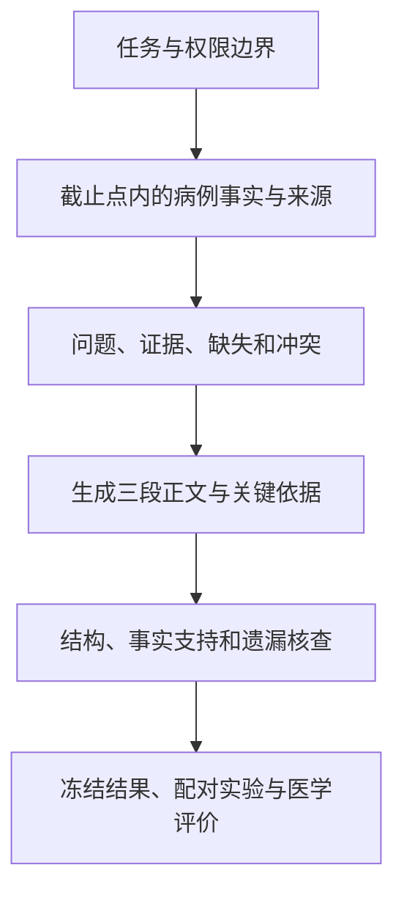

# 临床智录：研究依据、知识框架与实验决策

研究日期：2026-11-05。状态：第一轮定向文献研究与方法设计，尚无本项目真实 Qwen 实验结果。本文不改变正式算法、默认参数或提交协议。

检索范围包括 ACL Anthology、arXiv、npj Digital Medicine 与服务商官方文档，重点覆盖 2025—2026 年临床记录生成与证据问答，补充必要的早期基础研究。这不是系统综述，也不声称覆盖全部最新论文。下文区分论文报告、本项目推论与待验证假设；没有复现论文成绩。

## 1. 我们实际要解决什么

依据本地赛题 PDF、视频及 [逐项对照](REQUIREMENTS_TRACEABILITY.md)，任务是：在指定 Qwen、给定病例资料和截止点下，生成首次病程记录，并提供来源与待核事项。核心是事实忠实、拟诊有据、计划针对性、完整清楚及可追溯；网页承担复核，不是主要研究贡献。

普通推理 API 是让既有模型生成结果，不会因为我们发送病例就更新其权重。微调需要独立训练权限、适配的模型、数据与训练部署过程；服务商的训练接口与推理调用是不同流程。[阿里云模型调优文档](https://help.aliyun.com/zh/model-studio/fine-tuning-api-guide)

当前规则没有给我们更换指定模型、训练权重或增加外部评判模型的授权。因此主路线是固定模型下优化输入组织、生成约束、校验与评价。只有赛方明确允许且具备训练数据、算力和部署条件时，才重新评估 SFT、LoRA、偏好训练或强化学习。

## 2. 阅读依据与迁移边界

### R1：临床错误与遗漏的双向评价

Asgari 等，2025，npj Digital Medicine，*A framework to assess clinical safety and hallucination rates of LLMs for medical text summarisation*。[原文](https://www.nature.com/articles/s41746-025-01670-7)

- 已查阅可访问的摘要、实验结果与错误分类文本；原网页直连遇到跳转限制，正文相关段落通过官方页面检索结果取得，未完成补充材料审读。
- 论文将幻觉与遗漏分别评价，并区分可能改变诊疗的严重错误。在其一项实验中，先进行事实原子化抽取再生成反而增加严重幻觉和遗漏。
- 对我们的启发：必须双向核查，不能以“少写”换取表面上的低错误率；抽取流程需要实测。
- 边界：研究是就诊对话摘要；本赛题还要求提出初步判断和未来计划，不能把所有非逐字复述都判为幻觉。

### R2：证据定位和正文生成可以分开研究

Soni 等，2025，BioNLP，*Overview of the ArchEHR-QA 2025 Shared Task on Grounded Question Answering from Electronic Health Records*。[论文及 PDF](https://aclanthology.org/2025.bionlp-1.34/)

- 已核对任务、评价与系统方法相关正文。
- 在提交系统说明的 24 支队伍中，20 支采用先识别证据再生成的两阶段流程。这个比例是方法使用情况，不是两阶段必然更优的因果证据。
- 对我们的启发：分别评价证据是否找到、生成是否忠实、引用是否支持。
- 边界：回答患者问题与写完整首次病程记录不同；不能照搬问答任务的筛选阈值或最终评分。

### R3：多阶段有收益，也会传播错误

Hosen 等，2026，*HealthNLP_Retrievers at ArchEHR-QA 2026: Cascaded LLM Pipeline for Grounded Clinical Question Answering*。[全文](https://arxiv.org/html/2604.26880v1)

- 已查阅方法、错误分析及局限；arXiv 页面列有 CL4Health @ LREC 2026 会议出处。
- 系统串联问题解释、证据选择、生成与答案证据对齐；作者报告过严的对齐会损失召回，并指出前级错误会影响后续阶段。
- 对我们的启发：证据索引应辅助原文阅读；抽取遗漏不能直接令后续生成失去原文。
- 边界：使用 Gemini 且限定于该问答基准，不能据此预测指定 Qwen 的收益。借鉴机制，不引入其模型或假设已获其数据权限。

### R4：逐项核查与医生偏好不是同一个能力

Wang 等，2025，EMNLP，*Process-Supervised Reward Models for Verifying Clinical Note Generation: A Scalable Approach Guided by Domain Expertise*。[论文及 PDF](https://aclanthology.org/2025.emnlp-main.967/)

- 已查阅摘要、方法定义、结果与局限相关正文。
- 作者训练 LLaMA-3.1 8B 逐步验证器；报告辨别含错样本准确率 98.8%，选择医生偏好记录准确率 56.2%。二者任务和分母不同，不可相互替代。
- 对我们的启发：用临床意义明确的条目定位错误；受控错例检测强不代表真实记录质量高。
- 边界：训练独立验证器与 Best-of-N 不直接迁入当前受限赛题。我们已有的规则审计也不是论文中的 PRM。

### R5：用事实支持率与覆盖率组织目标

Jhaveri 等，2025，*Optimizing Long-Form Clinical Text Generation with Claim-Based Rewards*。[所读 v1 全文](https://arxiv.org/html/2510.02338v1)

- 已查阅方法、模型、训练设置及评价；这里按所读 arXiv v1 处理，不据第三方目录宣称录用状态。
- 作者结合 DocLens 条目评价与 GRPO，在 Llama-3.1-8B 上训练。原文的条目提取依赖 GPT-4o，另用 GPT-5 做偏好评价；不能将“无需人工参考”理解为完全无需模型评价或医生验证。
- 对我们的启发：把“生成事实受到支持的比例”和“重要原始事实被保留的比例”分开观察。
- 边界：先借鉴评价思想，暂不训练。模型评价可能有偏差；其英文 SOAP 结果不能当作中文首程记录的成绩。

### R6：训练可行，但前提远多于拿到 API

Wang 等，2025，Findings of ACL，*Towards Adapting Open-Source Large Language Models for Expert-Level Clinical Note Generation*。[论文](https://aclanthology.org/2025.findings-acl.626/)

- 本轮核对摘要与发表信息，尚未完成训练细节和附录审读。
- LLaMA-Clinic 结合继续预训练、监督微调与反馈学习，并通过医生阅读评价；作者强调预先定义合适的记录格式。
- 对我们的启发：先明确记录应包含什么、如何评价，再决定是否训练。
- 边界：不能复制其结果来证明我们的质量；现有少量公开练习病例不构成同等的训练和医生评价条件。

### R7：有引用编号不等于有证据支持

Gao 等，2023，EMNLP，*Enabling Large Language Models to Generate Text with Citations*（ALCE）。[论文](https://aclanthology.org/2023.emnlp-main.398/)

- 本轮核对摘要、任务说明与作者项目简介，未完整复现评价器。
- 该研究将带引用的生成及其支持程度作为独立研究对象，显示生成引用仍存在明显不足。
- 对我们的启发：来源编号合法、引用内容确实存在、引用内容支持结论，是三个不同层次。
- 边界：通用问答的自动蕴含判断不能直接作为临床正确性裁决。

### R8：无新增依据的自我反思不能默认有效

Huang 等，ICLR 2024，*Large Language Models Cannot Self-Correct Reasoning Yet*。[论文](https://arxiv.org/abs/2310.01798)

- 本轮核对摘要、版本及会议说明。
- 论文在所研究的推理任务中发现，无外部反馈的自我纠错可能无效甚至退化。
- 对我们的启发：修正应接收具体可定位的问题及原文，而非笼统要求“再想一遍”。
- 边界：不是所有新模型和所有修正方式永远无效的证明；本项目仍需要前后配对评价。

### R9：长上下文容量不等于重要信息一定被使用

Liu 等，TACL 2024，*Lost in the Middle: How Language Models Use Long Contexts*。[论文](https://arxiv.org/abs/2307.03172)

- 本轮核对摘要与任务设置，未复现其模型实验。
- 在其问答与检索设置中，相关信息位置影响表现。
- 对我们的启发：测试相同事实在开头、中间、末尾时的保留情况。
- 边界：不能推断当前 Qwen 必然有相同退化幅度，也不能据此不加验证地裁掉长病例。

## 3. 本项目的六层知识框架

下面是依据文献和赛题提出的项目设计，不是某一篇论文已经证明有效的完整方案。

### 第一层：任务边界

固定模型和版本、病例截止点、输入输出协议、调用与耗时预算、允许使用的材料。先排除不可提交的方法。默认不联网、不调用其他模型、不使用未获准知识库、不通过重复采样挑选漂亮结果。

### 第二层：患者事实

一个事实的工作表示是：来源与原文位置、对象、数值单位、时间、肯否状态、确定程度及结果可用时间。未知状态保留未知，不能默认为阴性或正常。多个来源冲突保留双方，并指出冲突。

现有事实台账只覆盖部分词法现象；后续重点是评估它的漏项、错归属及对模型的诱导，而不是把台账当作完整病历数据库。

### 第三层：问题与证据组织

拟研究的问题表：`主要问题 → 支持事实 → 相反或限制性事实 → 缺失资料 → 初步判断边界 → 对应计划方向`。它提供可核对的简短依据，不要求输出内部思维链。

示意：来源仅给出“某检验值异常”，可以记录该异常并提示病因待评估；不能补写从未提供的病程，或把病因写成已确诊。临床判断是否充分，交由医学评价。

这是当前最值得新增的候选研究点：检查拟诊与计划是否逐个回应患者的问题，而不只检查 JSON 和数字。问题表还未实现，是否增加独立模型调用需要预算和实验决定。

### 第四层：分开处理事实、推断与计划

| 内容类型 | 应满足的条件 | 不能混淆的情况 |
|---|---|---|
| 患者事实 | 能定位到截至当时可用的病例资料 | 未提供检查不能写成检查正常 |
| 初步判断与鉴别 | 有患者依据，表达不确定性，临床上合理 | 可能病因不能写成已经确诊 |
| 拟实施计划 | 对应问题与缺失资料，语义明确是未来建议 | 建议复查不能写成已经复查 |

医学知识可以参与形成初步判断和拟定计划，但不能创造患者事实。因而“原文未出现”不能独自判定一个建议是幻觉；应区分新患者事实、合理推断、无据推断与未来计划。

最终输出继续使用赛题五字段。更细的句子或条目证据映射作为开发评价材料，不擅自增加正式输出字段，也不把内部逐项核查误写成赛题要求每句附引用。

### 第五层：核查与有限修正

按三层核查：协议有效性；确定性规则可发现的数值、否定、时间及状态错误；需要语义或医学判断的支持关系、鉴别及计划充分性。当前第三层主要依赖人工，不能把已有规则包装成完整语义验证器。

只有出现预先规定的问题且预算允许时，候选方案才进行一次定向修正。记录修复了什么、引入了什么及修正失败情况。最终采用固定策略产物，不事后人工挑选原稿与修订稿。

### 第六层：评价与复现

把“是否运行成功”“写的是否有据”“该写的是否写到”“医学判断和计划是否合适”分开测量。方法变复杂只有在收益与额外代价都可解释时才有价值。

## 4. 如何判断方法真的变好

以下是拟采用的开发评价，不是赛方公布的权重或新的官方总分。

| 观察量 | 定义或审查方式 | 限制 |
|---|---|---|
| 可用输出率 | 协议正确且有完整正文的病例 / 全部输入病例 | 不是医学准确率；失败不剔除 |
| 患者事实支持率 | 经复核获得资料支持的输出患者事实 / 被审查的输出患者事实 | 推断和计划另评；无事实输出不记为 100% |
| 关键事实覆盖率 | 保留的预先标注关键事实 / 应保留关键事实 | 标注独立于生成结果；未标注不得当作满分 |
| 严重错误 | 人工确认可能影响判断或处置的错误病例数与类型 | 与普通措辞问题分开；不得用自动规则直接定级 |
| 引用支持 | 来源真实、语义支持、关键依据覆盖分别评价 | 编号正确不能替代支持关系 |
| 拟诊与计划质量 | 按赛题五维度由独立医学评审比较 | 不以文本相似度或同一模型自评分替代 |
| 修正净影响 | 修复错误、引入错误、失败变化分别计数 | 只看警告减少容易误判 |
| 运行代价 | 调用次数、实际耗时与可获取的 token | 缺失用量不补零；API 稳定性单独记录 |

病例是比较单位。相同输入、模型版本、参数和评价标准下做配对比较；长短文本及同一患者的多个片段不能冒充独立样本。报告改善、持平、退化与失败数；样本足够时按病例进行配对 bootstrap 区间估计，该统计功能目前尚未实现。少量留出病例只能提供初步证据，不承诺显著性或泛化效果。

合成测试与公开教学病例分开报告；MIMIC Demo 的结构化检验输入不能替代完整中文首程病例评价。既有 175 项测试和 142 例 MOCK 是工程证据，不是上述医学指标的观测值。

## 5. 待检验的假设和最小实验

先使用获准开发病例；数据按患者/原始病例划分，变体随原病例分组。开发集用于选方法，方法冻结后才评价留出集。预算不足时先缩小开发样本，不能用正式测试集反复调参。

| 顺序 | 方案与对照 | 模型调用 | 假设与失败信号 |
|---|---|---|---|
| E1 | 现有 baseline 对 grounded | 各 1 次/例 | 台账提高事实保留；若误归属或新增错误更多则不采用 |
| E2 | grounded 对 extract_generate | 1 对 2 次/例 | 逐字摘录辅助复杂病例；若遗漏上升或收益不足则保留单次方案 |
| E3 | grounded 对固定 repair | 1 对至多 2 次/例 | 明确反馈降低净错误；必须同时看新增错误及失败 |
| E4 | grounded 对问题—证据—计划约束提示 | 计划各 1 次/例 | 减少空泛计划和无据定论；若限制过度导致合理判断不足则修订 |
| E5 | 同一事实的排列、否定、单位、截止点和冲突变体 | 随被测方案 | 事实改变时相关输出应变，不相关事实应保持；由原病例分组评估 |

重要：现有 `baseline` 与 `grounded` 共用系统提示词，差别是台账及生成后规则审计；默认审计只记录、不改正文。因此 E1 可研究台账的生成效果，但规则警告应使用相同的离线评价器比较，不能声称是在与“完全没有约束的随便提问”比较。现有 repair 实验脚本预算配置为 3，默认无重试且最多一次修正，实际最多调用 2 次；E3 应显式设 `--max-calls 2`，避免预算解释不一致。E2 和 E3 应分别相对 grounded，不能混为一个多变量试验。E4 尚未实现，实施时需独立冻结提示词。现有扰动集覆盖部分 E5，位置和无关信息不变性测试仍待补充。

只有明确收益的组件才进入最终组合，再比较整个组合与基线。不要同时更换模型、提示词、抽取和修正后，将全部提升归因于某个单独组件。多阶段仅为候选；R1、R3 都提示其可能退化。

## 6. 现有资产、缺口与优先级

| 模块 | 当前情况 | 接下来需要的证据 |
|---|---|---|
| 批处理、隔离失败、日志与冻结运行 | 已实现并有工程测试 | 正式接口兼容性与真实耗时 |
| 词法台账、规则审计、摘录和一次修正 | 已实现可选方案 | 真 Qwen 配对结果及误报/漏报 |
| 关键事实标注与复核包 | 已有工具和部分合成标注 | 真实开发病例的独立医学标注 |
| 问题—证据—计划一致性 | 目前主要由提示词约束 | 独立评价标准和 E4 候选实现 |
| 引用语义支持 | 当前只做部分规则检查 | 逐项人工核查；自动候选判断须另验证 |
| 统计区间与位置鲁棒性 | 本文提出，尚未完整实现 | 开发评价工具与真实运行数据 |
| 权重训练与外部 RAG | 不作为当前主路线 | 赛方授权、数据、资源与收益证据 |

当前研究主张可表述为：在固定指定模型及有限调用条件下，利用带时间和来源的事实组织、问题对应的生成约束与可定位错误反馈，研究首次病程记录的忠实性和完整性。它是待验证的工程研究假设，不宣称原创算法突破或优于既有系统。

下一步优先补齐错误标注规范与实验配置，再接真实模型进行 E1。拿到 API 后首先测量问题分布，不立即训练，也不默认打开所有可选步骤。网页继续服务于复核；工程、论文阅读与医学效果证据分别陈述。
